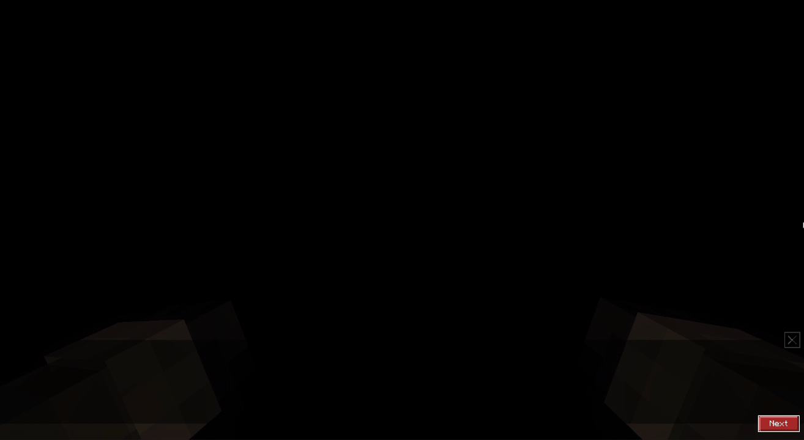
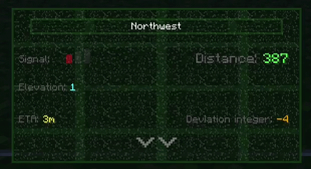
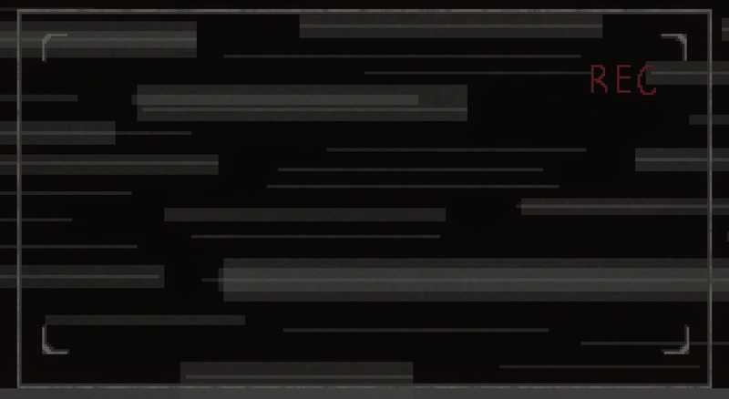
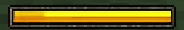
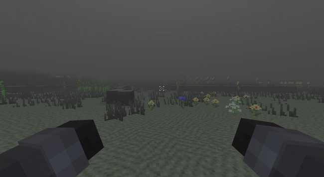
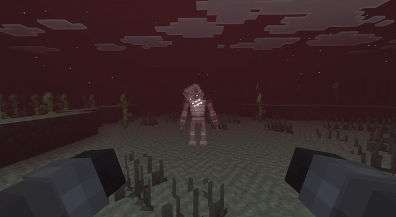

# Inside the Cage

> **Developed by [i-bexx](https://github.com/i-bexx)** — Minecraft Bedrock Systems & UI Developer  
> 📧 Discord: i_bexio

**Inside the Cage** is a multiplayer survival game built in Minecraft Bedrock Edition where players find and break 7 cages to free the trapped souls inside — made using only the built-in Script API and JSON UI, with no external mods.

  
   
  <i>Custom HUD showing the live 3D player icon, sanity status, camera overlay, stamina bar, and position alert.</i>

---

## 📊 Project at a Glance

| Metric | Value |
|:---|:---:|
| **Script API Files** | 44 |
| **JSON UI Files** | 43 |
| **Entity Files** | 16 |
| **Item Files** | 24 |
| **Particle Files** | 8 |

`JavaScript (ES6+)` · `Minecraft Script API` · `JSON UI` · `Molang` · `Blockbench`

---

## 🎮 Gameplay Showcase

### 1. Branching NPC Dialogue
An interactive NPC conversation system with player choices, saved memory, and entity animations.
- **Animated Dialogue UI:** Text reveals left-to-right inside a custom dialogue box instead of a plain Bedrock popup.
- **Choices That Matter:** Choosing *"Yes"* heals the injured NPC so he stands up, rewards you with items (`kit` and `discount_ticket`), and makes him remember your choice next time you talk to him.
- **Multiplayer Safe:** Locks the NPC while someone is talking to him so two players can't overlap conversations.

  

---

### 2. Handheld Radar Scanner (`Cage Detector`)
A tracking device players use to find the 7 hidden cages across the map, showing live tracking info inside a custom UI panel.
- **Live 3D Math:** Calculates 3D distance, compass direction, height difference, and walking ETA to a hidden cage.
- **Dynamic Signal:** Updates the signal bars based on how close you are.

  

---

### 3. VHS Camera Overlay & Sanity System
Players carry a full-screen camera that reacts when you look at Midnight Prayer.
- **Looking at Midnight Prayer:** Staring directly at Midnight Prayer drains your sanity over time, making the VHS static and screen shake worse.
- **Signal Loss & Game Over:** Freeing 6 souls cuts the camera signal and hides player coordinates, while dropping to zero sanity triggers an animated Game Over screen.

  <b>Normal Camera View</b> 
  
    
  <b>Glitch Camera View</b> 
  
    
  <b>Game Over Screen</b> 
  

---

### 4. Custom HUD
Every HUD element updates live from server scripts and custom JSON UI.

<table>
  <tr>
    <td align="center"><b>Live 3D Doll & Sanity Feedback</b> </td>
    <td align="center"><b>Shop, Vote & Upgrade Menu</b> </td>
  </tr>
  <tr>
    <td align="center"><b>Live Compass & Coordinates</b> </td>
    <td align="center"><b>Position Lost Alert</b> </td>
  </tr>
  <tr>
    <td align="center"><b>Stamina Depletion</b> </td>
    <td align="center"><b>Stamina Regeneration</b> </td>
  </tr>
  <tr>
    <td align="center"><b>Custom Toast Notification Popup</b> </td>
    <td align="center"><b>Inventory Slot Hover Animation</b> </td>
  </tr>
</table>

---

### 5. First-Person Hand & Item Animations
Custom two-handed first-person animations replacing vanilla's single arm, paired with custom item poses in 1st and 3rd person.
- **Empty-Hand Movement:** Both arms animate dynamically for idle, walking, sprinting, swimming, and attacking.
- **Weapons & Items:** Custom equip, hold, and use animations for some items (`gun`, `knife`) driven by Molang and synced player properties.
- **Dynamic Crosshair & Hitmarker:** Aiming at monsters, players, or mobs changes the custom crosshair color (`red`/`green`/`blue`), and shooting a monster triggers a 24-frame flipbook hitmarker animation.

  <b>Empty Hands</b> 
  
    
  <b>Gun & Knife</b> 
  

---

## 🛠️ Technical Architecture & Systems Deep Dive

### 1. Custom UI Using Server Forms, Titles & JSON UI
Minecraft Bedrock's `@minecraft/server-ui` `ActionFormData` is normally limited to plain text and basic buttons. To build animated dialogue, radar panels, and custom HUD popups without external mods:
- **Rendering Button Text as Dialogue:** Repurposed `form_buttons` so `conversation_text_panel` renders only `#form_button_text` as plain dialogue labels instead of clickable buttons (filtering out `Next`/`Ok` and using `collection_index: 2` for question text), while `collection_index: 0` and `1` render as actual choice buttons.
- **Switching Panels with Bindings:** Used `#form_text` view bindings to toggle the right panel for each stage (`conversation_start`, `question_part`, `farewell_part`).
- **Animations & Controller Support:** Added slide and fade animations (`random_peep_anims.json`) and set `$default_focus_precedence` so gamepad navigation works smoothly.
- **Custom Toast Popups:** Repurposed vanilla recipe toast notifications using `resolve_sibling_scope` to trigger custom alerts (like *"Coin Bag is Full"*).
- **Slot Hover Animations:** Replaced vanilla `common.container_slot_button_prototype` (`ui_common.json`) with `gray_slot_button` so each hovered item scales up smoothly.
- **Multiple HUD Elements via One Title/Subtitle:** Packs crosshair/hitmarker, compass, stamina, and curtain states into `#hud_subtitle_text_string` (`fastUiTick.js`) and sanity/notifications into `#hud_title_text_string` (`slowUiTick.js`), only calling `setTitle` when something changes (`renderUi.js`).
- **Spawning UI Elements (`#collection_length`):** Uses `collection_panel` factories (`hud_crosshair_overlay.json`, `round_complete_curtain.json`) that switch `#collection_length` from `0` to `1` to create the hitmarker and round-complete curtain so their animations play cleanly.

### 2. 3D Math & Line-of-Sight Detection (Script API)
- **Cage Detector Math:** Calculates 3D distance, height difference (ΔY), compass direction, and walking ETA live in the UI.
- **Looking at Midnight Prayer Check:** Checks if Midnight Prayer is within 20 blocks and inside the player's view (~106° cone using dot product ≥ 0.6), then uses `getBlockFromRay` to make sure no wall is blocking the view before triggering sanity drain and screen static.

### 3. Entity States & Client-Server Sync
- **Instant Visual Feedback:** Uses `client_sync: true` entity properties (`ibexx_itc:is_shooting`, `ibexx_itc:has_slowness`) so when server scripts or entity events update a property, client animations and Molang queries react right away.
- **Event-Based States:** Switches entity behaviors and effects cleanly with component groups and events (`normal_movement_event`, `curtain_close_event`, `static_low_sanity_event`).

### 4. Saving Data & Multiplayer Safety
- **Saved Progress:** Uses Bedrock `DynamicProperties` to save NPC dialogue choices (`isHealed`, `conversationIsConcluded`) and world state.
- **Per-Player State & Cleanup:** Keeps each player's state separated in `Map`s by player ID and clears their data/timers when they disconnect so memory doesn't leak in long sessions.

### 5. Live Debugging
- **VS Code Debugger:** Configured `.vscode/launch.json` (`minecraft-js`) for live breakpoints, call stacks, and variable inspection while the game is running.

---

## 📥 Project Status & License

**Inside the Cage** is still in development. A playable `.mcpack` build will be released once it's ready.

Published for portfolio viewing under [LICENSE](./LICENSE) (All Rights Reserved).
