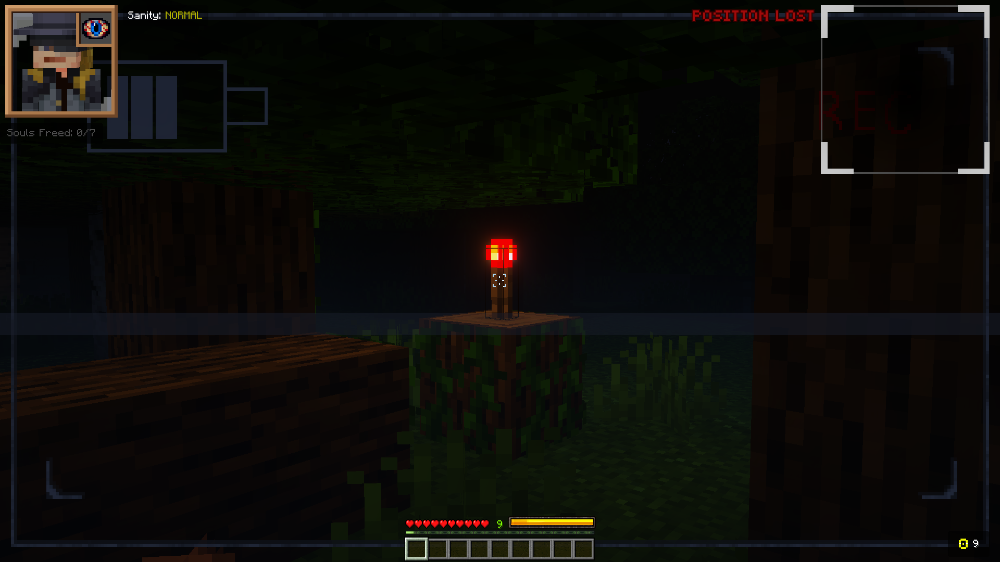
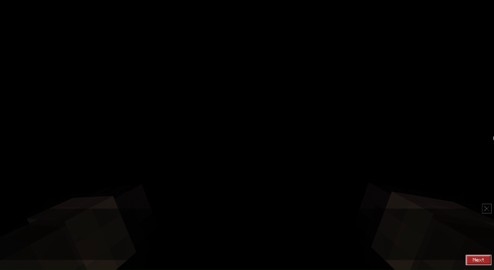
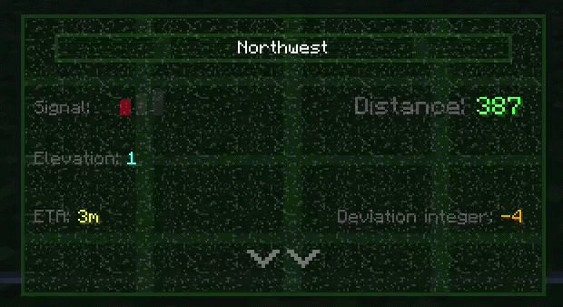
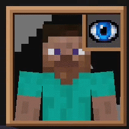
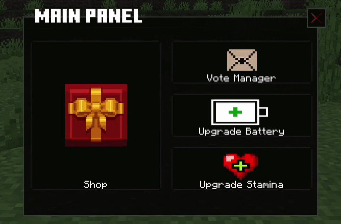
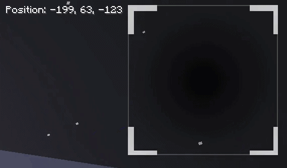
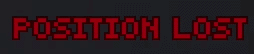
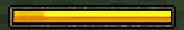
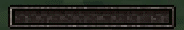

# Inside the Cage ⛓️

> **Developed by [i-bexx](https://github.com/i-bexx)** — Minecraft Bedrock Systems & UI Developer  
> 📧 yigitkarabacak364@gmail.com

**Inside the Cage** is a full-scale, multiplayer-ready survival and action experience built in Minecraft Bedrock Edition.

  
   
  <i>Custom in-game HUD featuring live 3D character rendering, stamina tracking, radar telemetry, and animated overlays.</i>

---

## 📊 Project at a Glance

| Metric | Value |
|:---|:---:|
| **Script API Files** | 45 |
| **JSON UI Files** | 43 |
| **Custom Entities** | 17 |
| **Custom Particle Systems** | 6 |

`JavaScript (ES6+)` · `Minecraft Script API` · `JSON UI` · `Molang` · `Blockbench` · `State Machines` · `Spatial Math`

---

## 🎮 Gameplay Showcase

### 1. Branching NPC Dialogue Engine
A multi-scene conversation system with player choices, persistent NPC memory, and synchronized entity animations—built entirely without external mods.
- **Typewriter Text Reveal:** Progressive left-to-right text animation with custom dialogue framing.
- **Choices With Consequences:** Selecting *"Yes"* triggers an entity animation where the injured NPC physically stands up; the NPC remembers your decision across visits.
- **Multiplayer Locking:** Prevents overlapping interactions while a player is mid-conversation.

  

---

### 2. Handheld Radar Scanner (`Cage Detector`)
A custom tracking device players use to hunt down 7 hidden cages across the map, displaying real-time spatial telemetry inside a custom UI panel.
- **Live 3D Math:** Calculates real-time 3D Euclidean distance, compass direction, elevation difference, and walking ETA.
- **Dynamic Signal & Noise:** Shifts signal-strength icons based on proximity, layered over a 3-phase flickering radar static animation.

  

---

### 3. VHS Camera Overlay & Line-of-Sight Sanity System
Players carry a custom camera that applies a full-screen lens overlay and interacts directly with enemy visibility.
- **Raycast Sanity Drain:** Maintaining line-of-sight with the Stalker triggers progressive sanity loss, intensifying VHS static, screen shake, and heartbeat audio.
- **Signal Interference:** Dropping to zero sanity triggers a full camera signal-loss state and animated Game Over sequence.

<table>
  <tr>
    <td align="center"><b>Active Camera View (Normal Signal)</b> </td>
    <td align="center"><b>Sanity Drain & Signal Interference</b> </td>
  </tr>
</table>

---

### 4. Real-Time HUD Telemetry, Stamina & Custom Alerts
Every element on the player's screen is dynamically driven by server state.

<table>
  <tr>
    <td align="center"><b>Live 3D Doll & Sanity Feedback</b> </td>
    <td align="center"><b>Dynamic Status Panel</b> </td>
  </tr>
  <tr>
    <td align="center"><b>Live Compass & Coordinates</b> </td>
    <td align="center"><b>Signal / Position Lost Alert</b> </td>
  </tr>
  <tr>
    <td align="center"><b>Stamina Depletion</b> </td>
    <td align="center"><b>Stamina Regeneration</b> </td>
  </tr>
</table>

  <b>Custom Toast Notification Popup (Vanilla Toast Hijacking)</b> 
  

---

<h3>🛠️ Click to Expand: Technical Architecture & Systems Deep Dive</h3>

 

### 1. Server Form Hijacking & Custom JSON UI Engine
Minecraft Bedrock's `@minecraft/server-ui` `ActionFormData` is fundamentally restricted to a flat text body and buttons. To build rich, animated RPG dialogue trees and telemetry panels without engine-level modding:
- **Button Collection Pipeline:** Repurposed the `form_buttons` collection as an indexed data transport pipeline. In dialogue scenes, `collection_index: 0` and `1` are bound to interactive choice buttons, while `collection_index: 2` is extracted into a custom `conversation_text_panel` to display dialogue strings.
- **View-Binding State Routing:** Filtered modal visibility and phase transitions (`conversation_start`, `question_part`, `farewell_part`) using `#form_text` view bindings.
- **Animation & Focus Engine:** Implemented procedural entrance/exit offsets and alpha fades (`random_peep_anims.json`) and configured gamepad `$default_focus_precedence` for seamless controller navigation.
- **Vanilla Toast Hijacking:** Repurposed the engine's hardcoded achievement/recipe toast notifications. By modifying scope resolution (`resolve_sibling_scope`), the system displays custom in-game alerts (e.g., *"Coin Bag is Full"*).

### 2. Spatial Telemetry & Raycast Mathematics (Script API)
- **Real-Time 3D Vector Math:** The `Cage Detector` computes Euclidean distance, elevation delta ($\Delta Y$), cardinal heading, and estimated walking arrival time (ETA) updated dynamically in the HUD.
- **Line-of-Sight & Sanity Raycasting:** Continuous spatial raycasting between player vectors and stalker bounding boxes drives the dynamic sanity state machine. Crossing the line-of-sight threshold triggers audio attenuation, camera shake, and procedural VHS post-processing overlays.

### 3. Entity State Machines & Client-Server Synchronization
- **Zero-Latency Visual Feedback:** Utilizes Bedrock Entity Properties with `client_sync: true` (`ibexx_itc:cursor_state`, `ibexx_itc:has_slowness`) to bridge server-side Script API logic directly to client-side animation controllers and Molang queries.
- **Component Group Architecture:** Granular state transitions driven by event queues (`normal_movement_event`, `curtain_close_event`, `static_low_sanity_event`) ensuring clean separation of entity capabilities.

### 4. Persistent Memory & State Management
- **Dynamic Property Storage:** Player dialogue history, quest completion flags (`isHealed`, `conversationIsConcluded`), and world states are persisted across server reboots using native Bedrock `DynamicProperties` without requiring external databases or server plugins.
- **Multiplayer Isolation:** State isolation using native `Map()` references keyed to player IDs, with lifecycle cleanup listeners on player disconnects to prevent memory leaks during extended sessions.

### 5. Tooling & Live Debugging
- **Live Script Debugging:** Fully configured `.vscode/launch.json` debugger attachment supporting live breakpoints, call stack inspection, and runtime variable watches via `minecraft-js`.

---

## 📥 Project Status

**Inside the Cage** is actively developed as a flagship technical showcase. A compiled `.mcpack` build will be released upon reaching the next major milestone.
